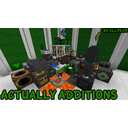

# Actually Additions — Horizon port (slice 1)

<p align="center"></p>

A Horizon port of [Actually Additions](https://github.com/Ellpeck/ActuallyAdditions)
by **Ellpeck** (MIT): the **Coal Generator** and the **Crusher**, with real FE,
working recipes and persistence.

**Status: slice 1 — two machines.** Everything else in the mod is a recorded gap
(below), not a silent claim.

## What works

- **Coal Generator** — burns any furnace fuel (including modded fuel, through the
  engine's cooking-fuel table) into a 60,000 FE buffer at 20 FE/t. The crafting
  remainder is returned (a lava bucket gives back a bucket).
- **Crusher** — a 60,000 FE buffer, 40 FE/t and 100 ticks per operation. It reads
  the mod's own `actuallyadditions:crushing` recipes: 47 of the jar's 49 (the
  `black_quartz_ore` and `rice` ones name items from later slices), with the
  second output rolled at its declared chance.
- **Energy transfer** — a generator pushes FE into an adjacent crusher. There is
  no Energy Laser Relay in this slice; adjacency is the documented stand-in.
- **Right-click interface** — right-click the generator with fuel, or the
  crusher with an input, to insert it; a wrong item is refused (nothing is taken
  and no block is placed). Hoppers/automation can insert into the same slots.
- **`/actuallyadditions info <x> <y> <z>`** — prints stored FE, burn time and
  crusher progress. This is a port addition for players without a GUI (there is
  no screen in this slice), not an upstream command.
- The machines keep their FE, burn state and crusher output across save and
  relaunch.

Both blocks, their items, loot tables, models, textures, the two machine recipes
and two advancements are carried from the jar.

## Not yet ported

- No GUI/screen for either machine (right-click and `info` are the interface).
- `lit` block state, particles and sounds; no comparator output for FE.
- A broken machine does not keep its FE (the energy component is not registered
  yet); the loot tables drop the block.
- The two machine crafting recipes ship but cannot craft yet: their ingredients
  (`black_quartz`, `restonia_crystal`, `iron_casing`, `basic_coil`) are later
  slices, and their `c:` tags do not exist in 26.3.
- The Double Crusher, the other ~45 machines, energy relays/cables, redstone
  control, the crafting chain, worldgen, the booklet, and client sync.

## Install

Drop `actuallyadditions.hnmod` into the launcher's mods folder (or install it
from the Horizon registry). One file installs both halves: the bundle embeds its
content package and registers it at load, so the blocks and the code arrive
together.

## Build from source

The bundle is built from this repository at Horizon `1d63e0a` /
horizon-mixins `5a64af93`:

```sh
cargo fmt --all -- --check
cargo clippy --all-targets --locked --offline -- -D warnings
cargo test --locked --offline                      # 15 runtime tests
python3 tools/package.py                           # actuallyadditions.hnmod
```

`tools/package.sh` also rebuilds the content package from `content/` with the
pin's `cargo-horizon-mod`. It needs a Horizon checkout at the pin and is meant
for the campaign harness:

```sh
HORIZON=/path/to/horizon-1d63e0a tools/package.sh
```

`tools/e2e.sh`, `tools/hmod-load.sh` and `tools/audit/` are the harness that
verified this slice in game; they expect a campaign checkout
(`CAMPAIGN_ROOT`) and the prepared 26.3 resources (`HORIZON_RES`).

## Compatibility

- Horizon `1d63e0a5a37a7a708eb0b32b49bf0dfeb28ed8a9`
- horizon-mixins `5a64af938ec86b00d53d16a408aabc0038fb3e57` (schema 6)
- Minecraft Java **26.3**

## Credits

Original mod: **Actually Additions** by Ellpeck —
<https://github.com/Ellpeck/ActuallyAdditions>. The jar's credits also name
BootyToast, GlenthorLP, canitzp (textures/models), Flanks, MrBysco and ErrorMikey
(porters) and Ridanisaurus (1.20+ textures). All carried assets come from the
ATM10 jar `actuallyadditions-1.3.26+mc1.21.1.jar`; provenance is in
[`LICENSE-NOTICE.md`](LICENSE-NOTICE.md).

Port to Horizon by AdLf0208. The Rust code is a clean-room rewrite; the upstream
Java was read for behaviour only.

## Licence

MIT — see [`LICENSE`](LICENSE). The original copyright and licence notices are
kept.

## Contributing / help wanted

The gap list above is the roadmap. The next useful slices are the GUI/menu for
the two machines, the `actuallyadditions:energy` item component (so a broken
machine keeps its FE) and the energy relay. Issues and pull requests are
welcome.
